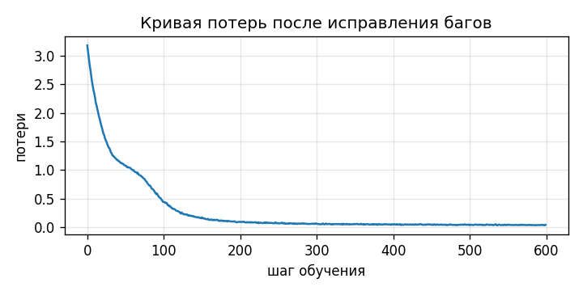

# Отчёт по ДЗ1

## Часть 1. Функции

В `dz1-attention.ipynb` дописал четыре функции:

- `split_heads`: reshape последней оси в (n_heads, d_head), потом permute, чтобы головы стали второй осью. Порядок важен: если сначала переставить оси, а потом сделать reshape, каналы перемешаются между головами.
- `merge_heads`: то же самое в обратную сторону.
- `scaled_dot_product_attention`: Q·Kᵀ / sqrt(d_k), потом маска (-inf на запрещённых позициях), softmax по последней оси (по ключам), dropout, умножение на V.
- `TransformerBlock.forward`: pre-norm, `x = x + attn(norm1(x))`, потом `x = x + ffn(norm2(x))`.

Все 17 проверок проходят.

## Часть 2. Баги (вариант seed 42)

Сначала прогнал проверки на исходном коде: прошло 7 из 17. Интересно, что лосс при этом нормально падал, а генерация выдавала набор случайных букв. Нашёл три ошибки:

| # | Где | Что ломается | Исправление |
|---|---|---|---|
| 1 | `sinusoidal_positional_encoding`, `torch.arange(1, length + 1)` | Позиции считаются с 1, а не с 0, поэтому каждая позиция получает кодировку следующей. На нулевой позиции синусы должны быть 0, а косинусы 1, здесь это не так. Модель всё равно учится, потому что позиции остаются различимыми, но кодирование не совпадает с формулой из статьи. | `torch.arange(length)` |
| 2 | `LayerNorm.forward`, `mean`/`var` по `dim=0` | Нормировка идёт по батчу, а не по признакам токена, получается batch norm. Выход для одного примера зависит от соседей по батчу. На генерации батч из одного примера: x - mean = 0, норма отдаёт нули, логиты все одинаковые, и символ выбирается случайно. Отсюда мусор в генерации при нормальном лоссе на обучении. | `dim=-1` |
| 3 | `scaled_dot_product_attention`, `softmax(..., dim=-2)` | softmax по запросам, а не по ключам. Строки весов перестают суммироваться к 1 (у меня от 0.06 до 0.54). Кроме того, в знаменатель попадают более поздние позиции, и модель начинает видеть будущее, хотя маска стоит. Тест на утечку будущего в исходном коде проходил только из-за бага 2: при батче из одного примера норма всё обнуляла. Когда я оставил только этот баг, тест упал. | `dim=-1` |

Каждый баг я ещё проверил отдельно: вносил его в уже исправленный код и смотрел, какие тесты падают.

После исправлений: 17 из 17.

## Часть 3. Обучение

Обучал ячейкой из ноутбука: 600 шагов, корпус из одной фразы, повторённой 200 раз (19 символов). Лосс 3.18 → 0.04.



Генерация (temperature 0.8, top_k 10):

```
ания смотрит на все позиции сразу. алгоритм внимания смотрит на все позиции сразу. алгоритм внимания смотрит на все позиции сразу. алгоритм внимания смотрит на все позиции сразу. алгоритм внимания смот
```

До исправлений на этом месте была случайная каша из букв.
